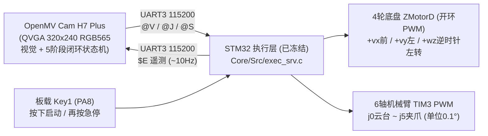
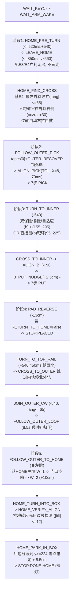

# 车型搬运竞赛机器人开发交接与 AI 快速切入说明书

> **分支**：`feat/auto-cube-pick` ｜ **当前主力比赛脚本**：`RUN_REV = "09-1127A"`（[`tools/field_tests/09_comp_closed_loop.py`](tools/field_tests/09_comp_closed_loop.py)）  
> **硬件底层状态**：STM32 执行层固件已冻结烧录，**严禁随意改动 C 固件**，所有迭代集中在 OpenMV 单文件脚本。  
> **配套文档**：硬件引脚/舵机标定见 [CALIBRATION.md](CALIBRATION.md)，历史录像索引见 [OPENMV_RUN_HISTORY.md](OPENMV_RUN_HISTORY.md)。

---

## 0. 给接手 AI 助手的 30 秒速读提示（可直接粘贴给 AI）

> 如果队友用 AI（Antigravity / Codex / Claude Code / Cursor 等）继续调试，直接把本文件发给 AI，并附一句：
> **“先通读 `COMPETITION_DEV_GUIDE.md`，唯一主力代码是 `tools/field_tests/09_comp_closed_loop.py`，不要修改已冻结的 STM32 C 代码，也不要改旧备份 `07`/`08`；任何视觉改动必须先用本地 `openmv/test13..29.mp4` 离线回放验证通过再刷板。”**

### 本车最核心的 4 条系统铁律
1. **单传感器 + 开环底盘**：全车只有 **OpenMV Cam H7 Plus** 一个传感器，STM32 底盘为**开环 PWM（无编码器、无陀螺仪）**。满电与低电转速可差 **1.5–1.7 倍**，**禁止用长开环毫秒定时决定转角或长距离到位**——定时器只能做超时保护或 ≤13 cm 短距脱障。
2. **比赛优先级（生死线）**：**放置分第一，回家分翻倍**。没放上 `(b)` 就是 **0 分**；稳放进 `(b)` 50 分环先锁死保底分，回家进 `32×32 cm` HOME 框让总分从 `0.5×` 翻回 `1.0×`；返程一旦异常必须原地刹停，**绝对不能回撞已放好的红柱**。顶部一键开关 `RETURN_TO_HOME = True/False` 可随时切回纯放置保底模式。
3. **避开静摩擦死区**：实测满电 `wz=640 ≈ 105°/s`，低电 `wz=640 ≈ 69°/s`，但降到 **`wz=440..480` 会掉进静摩擦悬崖（暴跌到 `~35°/s`，低电直接不动）**。所有连续视觉搜索统一用 **`wz=520..540`**，细调使用短脉冲（`70–110 ms` + 停稳读新帧）。
4. **先检测后画图**：所有 `img.draw_*` 调试叠画必须严格放在全部视觉检测函数执行完之后。

---

## 1. 硬件架构与冻结通信协议

### 关键物理与协议参数
- **整车与场地关键尺寸**：
  - 整车占地：**`21 cm`（宽）× `27 cm`（长）**；
  - `HOME` 方框：**`32 × 32 cm`** → 左右余量 `±5.5 cm`，**前后总余量仅 `5.0 cm`（`±2.5 cm`）**，因此进框深度必须靠视觉锚点，不能盲跑 `17 cm`！
  - 场地俯视方位（记忆基准）：**北 = 白墙自行车**，**东 = 大“2”号墙**，**南 = 橙色电梯门（`HOME` 在底边外轨南侧，“二维码”在 `HOME` 西侧）**，**西 = 大灰柱**。
- **串口与协议**（`P4 TX → PB11 RX`，`P5 RX → PB10 TX`，共地，`115200`，异或校验 `*XX\n`）：
  - `@V,<vx>,<vy>,<wz>,<ms>*XX`：`ms=0` 为流式控制（STM32 内部有 **`280 ms` 速度看门狗**，超时自动停轮）；`ms>0` 为定时脉冲。
  - `@J,<j0>,<j1>,<j2>,<j3>,<j4>,<j5>,0,<dur_ms>*XX`：**必须是 8 个整数参数**（第 7 位固定 `0`，第 8 位运动时长 `dur_ms`）。
  - `@S,0,0*XX` 软急停；`@S,1,0*XX` 心跳查询。
  - `$E,<armed>,<arm_st>,<arm_busy>,<holding>,<robot_st>,<arm_seq>*XX`：每步 `@J` 必须等 `arm_seq` 变化且 `arm_busy == 0` 才切下一步。
- **机械臂已标定姿态（单位 `0.1°`，与 `tools/grab_poses.json` 一致）**：
  - `ARM_HOME = (450, 918, 900, 990, 1035)`
  - `ARM_PRE = (450, 1120, 820, 1060, 1650)`
  - `ARM_ABOVE = (450, 1600, 680, 1130, 1650)`
  - `ARM_CONTACT = (450, 1799, 792, 1060, 1650)`
  - `JAW_OPEN = 900`，`JAW_CLAMPED = 1150`
- **抓取与对位基准**：`TARGET_CX = 130`，`TOL_X = 8`（已从 10 收紧防满电偏边缘顶盖），`TARGET_BOT_Y = 239`，`B_PUT_EXTRA_CM = 2.5`。

---

## 2. 仓库核心文件索引

| 文件 | 作用 | 状态 |
| :--- | :--- | :--- |
| **`tools/field_tests/09_comp_closed_loop.py`** | **最新主力比赛脚本（`09-1127A`）：完整 5 阶段纯视觉闭环** | **直接刷入 OpenMV `main.py` 使用** |
| `tools/field_tests/08_outer_return_home.py` | 独立外圈返程与左侧 HOME 入库验证脚本（`08-1126C`） | 历史对比/单测备份 |
| `tools/field_tests/07_comp_map.py` | 上一代全流程主脚本（`07-1126E`） | 历史对比备份 |
| `tools/field_tests/04_pick_cyl.py` / `05_mat_probe.py` | 单体抓柱测试 / 场地 LAB 阈值探针 | 标定辅助工具 |
| `Core/Src/exec_srv.c` / `Core/Inc/exec_srv.h` | STM32 执行服务、看门狗、`Key1` 门控、`$E` 遥测 | **已冻结烧录，勿改** |
| `tools/robot_host.py` / `tools/arm_grab_test.py` | PC 串口联调底盘与机械臂抓放（注意 CH340 打开会复位板子） | 桌面标定工具 |
| `openmv/test1..29.mp4` | 真实赛场 OpenMV 320×240 录屏（已 `.gitignore`，仅本地保存） | **离线回归测试核心数据集** |

---

## 3. 主力脚本 `09_comp_closed_loop.py`（`09-1127A`）5 阶段闭环设计

### 已在真实赛场录像（`openmv/test13..29.mp4`）上通过的离线回归指标
直接调用 `09_comp_closed_loop.py` 自身视觉函数对真实 320×240 视频逐帧回放（`py_compile` + AST 符号审计 `missing=0`）：
- **阶段 1（出 HOME）**：`test13 / 15 / 16 / 18 / 19`（成功）+ `test25`（满电过冲）+ `test26`（Run 1 & Run 3 摆在 `+` 后方）= **8/8 命中 `E4`**；`test27`（3 次内岛 `+` 误锁劫持）= **0/3 误触发（100% 屏蔽）**。
- **阶段 2（抓柱）**：`TOL_X = 8`、`FINE_YAW_PULSE_MS = 70` 单测通过，解决满电一脚脉冲甩偏导致黄夹爪顶在红柱上沿的问题。
- **阶段 3（进 `(b)`）**：`test15 / 16 / 18 / 19` = **4/4 命中**（`detect_b_ring` 直接锁环分别命中 `4/8/8/7` 帧，`detect_b_cross` 命中 `test18/19`）。
- **阶段 4（北直道并外圈）**：`test29` 实测 `detect_outer_rail_ahead` 命中 `2` 帧，`JOIN_OUTER_CW`（`ang <= 65°`）命中 `2` 帧。
- **阶段 5（抗反光进 HOME）**：`test28 00:23–26` 走廊地砖顶灯强反光帧 **10/11 帧稳锁**（准确输出 `tilt ≈ -45`）；`test22 00:15–16` 内圈弯道干扰 **0 误触发**。

---

## 4. 队友实测与现场调参 SOP

### 4.1 刷写与顶部一键开关
用 OpenMV IDE 打开 [`tools/field_tests/09_comp_closed_loop.py`](tools/field_tests/09_comp_closed_loop.py) → `工具 → 将打开的脚本保存到 OpenMV Cam（作为 main.py）`，确认 HUD 右上角显示 **`09-1127A`**。

| 开关（文件第 36–37 行） | 可选值 | 用途 |
| :--- | :--- | :--- |
| **`RETURN_TO_HOME`** | `True`（默认）/ `False` | 设为 `False` 时放完 `(b)` 后退 `13 cm` 直接亮绿灯停 `PLACED`（极端保底不冒返程风险） |
| **`TEST_STAGE`** | `"FULL_1_BLOCK"`（默认） | 正式比赛整趟 |
| | `"EXIT_TEST"` | 单测阶段 1（出 HOME 锁外轨后即停 `EXIT OK`） |
| | `"B_PICK_PLACE"` | 单测阶段 1→2→3（抓放 `(b)` 后退 13 cm 停 `PLACED`） |
| | `"B_APPROACH_TEST"` / `"B_RING_TEST"` | 摆在抓柱位 / 面对 `(b)` 单测靶环对位（不动臂） |
| | `"FROM_B_OUTER_LOOP"` | 摆在 `(b)` 放完姿态单测阶段 4+5（上北直道回 HOME） |
| | `"HOME_LEFT_TEST"` | 摆在底边外轨 `HOME` 东侧朝西，单测阶段 5 两堵墙 + 入框 |

### 4.2 没有场地时在宿舍就能完成的 2 项标定（强烈建议赛前做！）
1. **红柱桌面抓放复核（排除 `test27` 顶盖隐患）**：普通桌面放一根红柱，运行抓放测试或看机械臂归中，确认最底下的云台舵机 `j0=450` 每次归正无松旷回差，确认爪子能稳稳垂直提起红柱。
2. **黑胶带贴 `32×32 cm` 假框标定 HOME 停车深度**：地板上贴一个 `32×32 cm` 方框，把 `21×27 cm` 车手摆在框正中（前后各留 `2.5 cm`），看 OpenMV 预览画面：
   - 如果后边线仍在画面底部（比如 `y = 228`），直接把 `09_comp_closed_loop.py` 里的 **`HOME_PARK_STOP_Y = 228`** 填上即可实现纯视觉刹停；
   - 如果后边线刚好滚出画面底边几厘米，就实测从后边线到 `y = 224` 离最终正中差几厘米，微调 **`HOME_POST_ANCHOR_CM`**（当前默认 `5.5 cm`）。

### 4.3 脱机日志与停机码速查（`F:\map_last_run.txt`）
每次运行结束自动写入 OpenMV U 盘 `F:\map_last_run.txt`（例：`rev=09-1127A stage=... stop=... ring=... walls=... back_y=... tilt=... anchor=...`）：
- **绿灯常亮** = 成功：`DONE HOME` / `PLACED` / `EXIT OK` / `B AIM READY`。
- **蓝灯闪烁** = `WAIT_KEY1` 待机按 `Key1` 启动；**青灯常亮** = 机械臂 7 步动作中。
- **红蓝快闪** = 保护刹停，按 `STOP:xxx` 排查：
  - `NO HOME X`：出 HOME 超时未见 E4（检查白底阈值或起点是否偏离 HOME 框太多）。
  - `NO B TARGET` / `NO B RING`：抓完进内圈未见 `(b)` `+` 或靶环（核对 `TO_INNER_CROSS_MIN_X..MAX_X = 155..295`）。
  - `NO OUT RAIL` / `JOIN CW TO`：放完 `(b)` 上北外轨超时（核对 `NW_TURN_MS = 450` 是否正对北直道）。
  - `NO HOME` / `NO HOME WALL` / `HOME ALIGN`：回 HOME 阶段异常（切 `HOME_LEFT_TEST` 5 秒定位，核对 `HOME_WALL2_ADVANCE_CM = 10.0`）。
  - `ARM TO` / `LINK LOST`：机械臂超时或 STM32 断链（检查电池电量与 P4/P5 串口线）。

---

## 5. 前 29 次实测踩过的血泪避坑清单（接手人与 AI 必看）

1. **阴影侧白垫灰度只有 `114–122`**：靠白墙（北侧 `(b)` 区域）处于阴影，旧代码 `_is_cross_ring16` 写死 `hi >= 135` 会把 `(b)` 旁所有真 `+` 杀光！必须保持 **`hi >= 85` + 相对对比度 `(hi - base) >= 24`**。
2. **旋转时 `+` 歪 `20°–35°` 会压住外接框对角**：旧的“四角白底”十字检测在旋转中必漏检；必须坚持用 **16 点椭圆环 `_is_cross_ring16`（`runs == 4`）**，对 `0°–45°` 任意倾角不变且严格拒绝斜直线/T 口/L 角。
3. **出 HOME 绝不能只认孤立 `+`**：在 `HOME` 里左转 `~30°` 时会先扫过**内岛干扰 `+`**（`test27` 连踩 3 次掉进内圈）。必须坚持 **E3（双轨夹 `+`）/ E4（最左外轨竖立 + `+` 在外轨右侧）** 复合地标。
4. **近景直行外轨透视斜角可达 `56°–60°`**：锁线角度上限必须放宽到 **`<= 65°`**（`test26` 和 `test29` 实测 `56.0° / 59.4°`，卡死 `50°` 会漏锁）。
5. **走廊地砖顶灯反光可亮到 `170–190`**：回 HOME 面对走廊时，后边线上方地砖反光几乎和白垫一样亮（`test28 00:24`），绝对不能用 `above_g <= 145` 过滤；必须保留抗反光版 `detect_home_back_wall`（结合 `y=65..114` 墙/门暗度 + 最远笔直黑边线）。
6. **`HOME` 门口宽 `32 cm` 超出近端视场**：站在 `HOME` 门口时左右两堵侧墙同时在画面里放不下（`test22 00:13`），绝不能退回双侧墙 `detect_home_box` 做门口转向锁。
7. **底边找 HOME 时必须关闭 `OUTER_RECOVER` 和 `prefer_leftmost`**：否则左侧 `HOME` 边框和“二维码”线会被误判为“左侧外轨”，触发连续左跳（`test22` 曾触发 `shifts=9`）。
8. **电池管理**：比赛尽量保持每次上场电量在 **`11.6–12.3V`** 区间（低于 `11.4V` 换电），并切记 OpenMV 脱机跑的永远是 `F:\main.py`，改完代码务必刷入并核对 HUD `RUN_REV`。
9. **无场地离线验证方法**：本地 Python 环境已装 `imageio_ffmpeg + PIL + numpy`，AI 可直接解码 `openmv/test*.mp4`（剥离 `y=152/172/192` 的 1 px 灰色叠画扫描线）把改动后的检测函数对真实赛场录像逐帧跑回归测试，确认 0 回归后再上真车。
