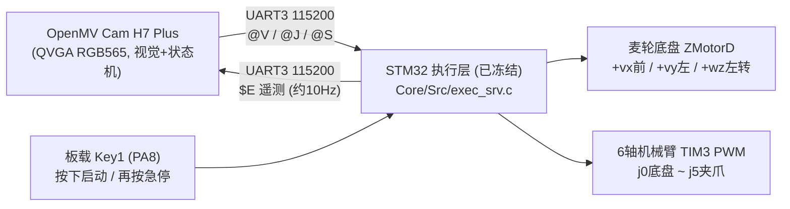
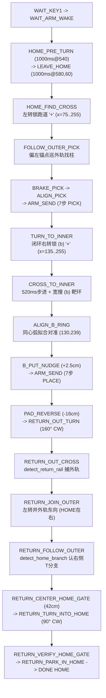

# 车型搬运竞赛机器人开发交接说明书（队友接手指南）

> **分支**：`feat/auto-cube-pick` ｜ **当前主脚本版本**：`RUN_REV = "07-1126D"`（[tools/field_tests/07_comp_map.py](tools/field_tests/07_comp_map.py)）  
> **硬件底层状态**：STM32 执行层固件已冻结烧录，**不要轻易改动 C 固件**，后续迭代集中在 OpenMV 上位机脚本。  
> **配套参考**：硬件引脚/舵机标定见 [CALIBRATION.md](CALIBRATION.md)，历史录像索引见 [OPENMV_RUN_HISTORY.md](OPENMV_RUN_HISTORY.md)。

---

## 1. 系统架构与通信契约（5 分钟看懂）

整个系统分为**冻结下位机执行层（STM32）**和**可快速迭代上位机决策层（OpenMV Cam H7 Plus）**：

### 关键硬件与协议约束
- **串口连接**：OpenMV `P4 (TX)` → STM32 `PB11 (RX)`，OpenMV `P5 (RX)` → STM32 `PB10 (TX)`，共地 `GND`，波特率 `115200`。
- **上行命令（OpenMV → STM32，带 XOR 校验 `*XX\n`）**：
  - `@V,<vx>,<vy>,<wz>,<ms>*XX`：底盘速度控制。`ms=0` 为流式控制（STM32 内部有 **`280 ms` 看门狗**，超时自动停轮）；`ms>0` 为定时脉冲（常用于近景精细点动对齐）。
  - `@J,<j0>,<j1>,<j2>,<j3>,<j4>,<j5>,0,<dur_ms>*XX`：6 轴关节绝对角度（单位 **`0.1°`**）。**注意必须是 8 个整数参数**（第 7 位保留填 `0`，第 8 位为运动时长 `dur_ms`），否则下位机不会按 `dur_ms` 插补。
  - `@S,0,0*XX`：软急停（停底盘和机械臂）；`@S,1,0*XX`：查询心跳。
- **下行遥测（STM32 → OpenMV）**：
  - `$E,<armed>,<arm_st>,<arm_busy>,<holding>,<robot_st>,<arm_seq>*XX`
  - 每次执行 `@J` 必须确认 `arm_seq` 递增且 `arm_busy == 0` 才算到位，**禁止靠纯延时盲切下一步**。
- **启动/急停机制（`Key1` / `PA8`）**：
  - OpenMV 要求先看到一次 `armed == 0`（`READY KEY1`），按下 `Key1` 变成 `armed == 1` 后才会启动状态机；运行中再按 `Key1` 或用手遮住镜头（`l_mean <= 10` 连续 8 帧）立即急停锁死。
- **PC 调试工具**（注意：通过 CH340 打开串口会触发 DTR/RTS 复位 STM32）：
  - 查底盘/状态：`python tools/robot_host.py --port COM22 drive 560 0 0 --time 500`
  - 单测机械臂抓放：`python tools/arm_grab_test.py --check`（标定姿态保存在 `tools/grab_poses.json`）

---

## 2. 仓库核心文件导览

| 文件 | 作用 | 当前状态 |
| :--- | :--- | :--- |
| `Core/Src/exec_srv.c` / `Core/Inc/exec_srv.h` | STM32 执行服务、看门狗、`Key1` 门控、`$E` 遥测 | **已冻结，已烧录，勿随意改** |
| `tools/grab_poses.json` & `tools/arm_grab_test.py` | 6 轴抓取/放置姿态标定与主机校验工具 | **已标定验证通过** |
| `tools/field_tests/04_pick_cyl.py` | 单体圆柱视觉对位 + 7 步抓放测试脚本 | **已实车 5/5 验证通过** |
| `tools/field_tests/05_mat_probe.py` | 场地无动作视觉探针（测各色圆柱/十字/黑线 LAB） | 辅助标定工具 |
| `tools/field_tests/06_track_and_pick.py` | 出 `HOME` → 外轨巡线 → 抓第 1 块圆柱半程脚本 | **已实车验证通过** |
| **`tools/field_tests/07_comp_map.py`** | **竞赛主状态机（`07-1126D`）：出 HOME → 抓 → 放 `(b)` → 回 HOME** | **当前主力开发文件** |
| `openmv/test1..21.mp4`, `VID_20261126_*.mp4` | OpenMV 录屏与手机俯拍（已 `.gitignore`，仅本地留档） | 复盘依据 |

---

## 3. 当前实测进度总览（截至 `test21` & `07-1126D`）

### 已稳定跑通的环节
1. **自主出 `HOME` + 跑道 `+` 十字定外轨**：`HOME_PRE_TURN (1000ms @ wz=540)` → `LEAVE_HOME (1000ms @ vx=580, wz=60)` → `HOME_FIND_CROSS` 紫框锁定跑道 `+` 十字 → 偏左锚点（`OUTER_LOCK_INIT_CX = 40.0`）切入外轨，**`test14`–`test21` 连续稳定不进内圈**。
2. **外轨寻柱 + 视觉对位 + 7 步机械臂抓取**：已解决黑线误报黑柱 `K`（`black_blob_follows_tape`），**`test14`–`test21` 连续 7 趟稳定抓起红圆柱**。
3. **靶环 `(b)` 同心弧对位 + 50 分靶心立放**：`ALIGN_B_RING`（基于局部对比度多行同心弦拟合）+ `B_PUT_EXTRA_CM = 2.5 cm` 前挪 + 7 步 `PLACE_STEPS`，**`test15`、`test16`、`test18`、`test19` 多次实测稳立在 `(b)` 中心 50 分靶环内**。
4. **放完柱后退出并捕回外轨**：`PAD_REVERSE (16 cm)` → `RETURN_OUT_TURN (160° CW)` → `RETURN_OUT_CROSS`（`detect_return_rail` 双侧白垫校验，拒绝垫外边界）→ `RETURN_JOIN_OUTER`。

### 本次刚改完、待满电实测的最后两处（`07-1126D`）
1. **夹完后的 `TURN_TO_INNER` 已由开环 `85°` 改为闭环认 `(b)` `+` 十字**：
   - 原因：`test20`/`test21` 凌晨电池掉压导致开环 `85°` 少转 `15°–20°`，把 `(b)` 甩到画面最右边缘出界。
   - `07-1126D` 改为右转过 `55°` 后盯住 `(b)` 门口 `+` 十字（`x ∈ [135, 255], bot >= 148`，上限 `175°`），不再受电量影响；同时 `CROSS_STEP_MS` 提到 `520 ms`，`scan_b_ring` 初搜中心改为画面正中 `160`（覆盖 `[22, 298]`）。
2. **回 `HOME` 门框识别防误触 + 门口微调**：
   - `detect_home_branch` 第 485 行由 `max(...) >= 145` 改为 **`min(...) >= 145`**（要求 `HOME` 侧边黑线上下两侧都是亮白垫，解决 `test18` 把垫外暗地砖当成 `HOME` 分支提前右转的问题）。
   - `RETURN_VERIFY_HOME_GATE` 增加 `home_box` 偏心时的自动微调转向（`1400 ms` 预算）；停入深度 **`HOME_PARK_STOP_Y = None`** 尚未用实车停稳帧标定，首次真进框会安全停报 `HOME CHECK`。

---

## 4. 已实测标定的硬参数速查表（`07_comp_map.py`）

### 4.1 底盘运动学标定（实测场地铺垫）
| 实测命令 | 实测结果 | 拟合公式 |
| :--- | :--- | :--- |
| `drive 560 0 0 --time 500` | 前进 `6.2 cm` | 稳态速度 **`16.0 cm/s`**，起步死区 **`112 ms`** |
| `drive 560 0 0 --time 1000` | 前进 `14.2 cm` | `cm_to_ms(cm) = round(112 + cm * 1000 / 16.0)` |
| `drive 0 0 640 --time 1300` | 原地左转 `90°` | `deg_to_ms(deg) = round(deg / 90.0 * 1300)` |

### 4.2 机械臂 6 轴抓取/放置姿态（单位 `0.1°`，与 `tools/grab_poses.json` 一致）
- `ARM_HOME = (450, 918, 900, 990, 1035)`（收纳行进姿态）
- `ARM_PRE = (450, 1120, 820, 1060, 1650)`（`j4=165.0°` 水平手腕预备）
- `ARM_ABOVE = (450, 1600, 680, 1130, 1650)`（目标正上方悬停）
- `ARM_CONTACT = (450, 1799, 792, 1060, 1650)`（抓柱与放柱共用同一触地姿态）
- 夹爪：`JAW_OPEN = 900`（张开），`JAW_CLAMPED = 1150`（夹紧圆柱）

### 4.3 视觉对位与颜色阈值（QVGA `320×240` RGB565）
- **抓取 & 靶心绿十字基准**：`TARGET_CX = 130`、`TOL_X = 10`、`TARGET_BOT_Y = 239`、`TOL_Y_NEAR = 236..240`、`MAX_CLIP_TOP_Y = 192`。
- **5 色圆柱阈值**：
  - 红 `THR_RED = (10, 95, 18, 127, 0, 127)`
  - 蓝 `THR_BLUE = (10, 90, -35, 35, -128, -18)`
  - 绿 `THR_GREEN = (10, 85, -128, -14, 5, 127)`
  - 黑 `THR_BLACK = (0, 15, -14, 14, -14, 14)`（`merge=False` + `black_blob_follows_tape` 沿顶边追踪窄轨排雷）
  - 白 `ENABLE_WHITE = False`（已写 3D 侧影检测 `detect_white_cyl`，**默认关闭**，开启前需在场地无白块空垫上确认零误报）
- **`+` 十字检测（`detect_cross`）**：`THR_CROSS = (0, 44, -18, 18, -18, 18)`，`8 <= h <= 115`，`w <= 7.5 * h`，`0.18 <= sol <= 0.62`，5 个臂点 `<= 110` 且至少 3 个角亮于臂点 `>= 22`（兼容远距扁平透视十字）。

---

## 5. 主状态机流程与分段调试开关

### 6 种分段测试开关（修改 `07_comp_map.py` 第 33 行 `TEST_STAGE`）
| `TEST_STAGE` 值 | 摆放位置 | 作用 |
| :--- | :--- | :--- |
| **`"FULL_1_BLOCK"`**（当前默认） | 车停在 `HOME` 框内面朝北 | 完整 1 块搬运 + 放 `(b)` + 自主回 `HOME` |
| `"OUTER_PICK_ONLY"` | 车停在 `HOME` 框内 | 出框 → 巡外轨 → 夹起第 1 块后即停（报 `PICKED`） |
| `"B_PICK_PLACE"` | 车停在 `HOME` 框内 | 抓第 1 块并放到 `(b)` 后原地停（报 `B PUT DONE`） |
| `"B_APPROACH_TEST"` | 车摆在外轨抓柱停位、面朝西 | 不动臂，单测 `TURN_TO_INNER → CROSS_TO_INNER → ALIGN_B_RING` |
| `"B_RING_TEST"` | 车手动摆在内圈、面朝 `(b)` | 单测靶环视觉对位（待机可预览 `B=x,y`，到位报 `B AIM READY`） |
| `"HOME_RETURN_TEST"` | 车摆在底边外轨东向（`HOME` 在右） | 单测认 `HOME` 右侧 T 分支 → 走 `42 cm` → 右转入框停车 |

### 脱机日志与排障速查
- **刷写脱机运行**：OpenMV IDE 打开 `tools/field_tests/07_comp_map.py` → `工具 → 将打开的脚本保存到 OpenMV Cam（作为 main.py）`（或直接覆盖 `F:\main.py`），**确认 HUD 右上角显示 `07-1126D`**。
- **脱机运行记录**：每次停机/掉链会自动写入 OpenMV U 盘 **`F:\map_last_run.txt`**，格式示例：
  `rev=07-1126D mode=FULL_1_BLOCK stage=CROSS_TO_INNER stop=NO B RING elapsed_ms=... cross_steps=... cross_hits=... ring=...`
- **LED 含义**：蓝灯闪 = 等待 `Key1`；青色常亮 = 机械臂动作中；绿灯常亮 = 正常运行或成功停机；红蓝交替快闪 = 故障锁停（看 HUD 顶部 `STOP:xxx`）。

---

## 6. 队友接手后的实测与开发 SOP

### 第一阶段：充完电，先把 1-Block 全程彻底跑通（预计 2–3 趟）
1. **换上满电电池**，将最新 `07_comp_map.py`（`07-1126D`，默认 `FULL_1_BLOCK`）覆盖到 OpenMV，在外轨放 1 个彩色圆柱，直接按 `Key1` 跑全程并同时录 OpenMV 画面 + 手机俯拍。
2. **按停机码 `STOP:xxx` 定点微调（每次只改一个参数）**：
   - `STOP:NO B CROSS`：看录像里 `(b)` 门口的 `+` 十字在 `TURN_TO_INNER` 时实际落到哪个 `x` 区间，微调 `TO_INNER_CROSS_MIN_X` / `TO_INNER_CROSS_MAX_X`（当前 `135..255`）。
   - `STOP:NO B RING`：看 `map_last_run.txt` 的 `cross_steps` 与 `cross_hits`，若还没走到 `(b)` 清晰区就用完步数，可调大 `CROSS_STEP_MS`（当前 `520`）或 `CROSS_STEP_LIMIT`（当前 `7`）。
   - `STOP:NO OUT LN`：看 `RETURN_OUT_CROSS` 画面里外轨出现位置，核对 `RETURN_OUT_TURN_DEG`（当前 `160.0`）是否正朝南以及 `RETURN_OUT_RAIL_Y`（当前 `210`）。
   - `STOP:NO HOME` / `HOME ALIGN` / `NO HOME BOX`：切 `TEST_STAGE = "HOME_RETURN_TEST"` 在 `HOME` 西侧外轨快速复测 `5` 秒，按转正后画面微调 `HOME_BRANCH_ADVANCE_CM`（当前 `42.0`）或 `HOME_TURN_DEG`（当前 `90.0`）。
   - **`STOP:HOME CHECK`（说明已经真开进 `HOME` 框了！）**：看手机俯拍确认整车是否完全在 `320×320 mm` 方框内，读取此时 OpenMV 终端日志里的 `box_y=<数值>`，把该数值填进第 213 行 **`HOME_PARK_STOP_Y = <数值>`**，之后成功停入即显示 **`STOP:DONE HOME`** 并亮绿灯！

### 第二阶段：向多块搬运与高分冲刺（时间充裕时）
1. **压缩对位耗时**：`ALIGN_B_RING` 实测单块约 `15–20 s`；若冲多块，可继续观察 `B_RING_FAR_STEP_MS (560)` / `B_RING_MID_STEP_MS (365)` 并在确认不超调后适当减小停稳帧数。
2. **5 色全覆盖**：红/蓝/绿/黑已开启；若需抓白圆柱，先在空场地垫上单独开 `ENABLE_WHITE = True` 跑一圈确认 `detect_white_cyl` 不误报地垫褶皱。
3. **多靶位规划（`a–e`）**：官方赛规任意圆柱放任意靶位均得分，且**未回 `HOME` 停车总分 ×0.5**。建议确保 **1 块 + 回 `HOME` 100% 稳过**后，再从 `(b)` 拓展到 2–3 块（按由远及近顺序放置，避免已放物块挡路，并监控总赛时留足最后 20 秒回 `HOME`）。

---

## 7. 避坑清单（前 21 次实测踩过的坑）

1. **电池电量会明显改变所有开环转向角**：满电时 `wz=640 × 1300ms = 90°`，低电时同样时间可能只转 `70°`。凡是关键转弯优先用视觉地标闭环（如 `HOME_FIND_CROSS`、`TURN_TO_INNER`），**比赛/联调前务必保持满电**。
2. **严禁先画 Debug 标记再跑检测**：所有 `img.draw_*` 必须放在 `detect_line / detect_cylinder / detect_cross / detect_b_ring / detect_home_branch / detect_home_box` 全部执行之后。
3. **垫外暗地砖反光极易造成单边阶跃误检**：检测外轨横线和 `HOME` 侧边线时，**必须验证黑线前后/上下两侧都是亮白垫**（`min(...)`），不能用单侧 `max(...)`。
4. **不要把 `scan_b_ring` 做得过重**：OpenMV MicroPython 像素循环很吃 CPU，`wide_acquire` 单帧耗时接近 `0.8 s`；后续优化视觉时务必注意帧率，避免超过 STM32 `280 ms` 速度看门狗或 `700 ms` 断联门限。
5. **脱机测试前一定核对版本号**：曾出现 IDE 里改了代码但 OpenMV 脱机跑的还是旧 `F:\main.py` 的情况，务必看 HUD 右上角 `RUN_REV` 和 `F:\map_last_run.txt` 的 `rev=` 字段确认已刷新。
6. **多智能体协作说明**：本仓库使用 `mcp-agent-mail` + `memory` 同步进度（详见项目规则），若队友继续借助 AI 协作，修改共享代码前请留意最新 `07_comp_map.py` 与 `git log`。
